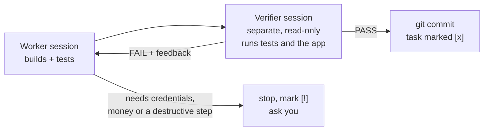

<div align="center">


# excudra

**Guardrails and an autonomous build loop for Claude Code.**
Free, local, open source. No account, no server, no telemetry.


[Watch the launch video (57s)](assets/launch.mp4)

</div>

---

Claude Code is fast enough now that the bottleneck is trust. Agents have [wiped production databases in seconds](https://oecd.ai/en/incidents/2026-04-27-6153), [installed packages that don't exist](https://labs.cloudsecurityalliance.org/research/csa-research-note-slopsquatting-ai-supply-chain-20260419/), and [edited tests until they passed](https://arxiv.org/html/2605.21384v1). Long sessions also drift once the context is compacted.

excudra is a Claude Code plugin that fixes those failure modes with plain local hooks, and a runner that takes a task list and keeps going until every task is **independently verified**, so you can hand off work instead of babysitting it.

## Install

Inside Claude Code:

```
/plugin marketplace add LovekeshAnand/excudra
/plugin install excudra@excudra
```

On Claude Code 2.1.275 or later this is one step: `/plugin install excudra --marketplace LovekeshAnand/excudra`.

Requirements: Claude Code, Python 3.9+, git. On Windows, Claude Code must use Git Bash (the default when Git for Windows is installed).

The guard hooks are active as soon as the plugin is enabled. Nothing else to configure.

## What you get

### Guard: always-on hooks

| Hook | Catches | Example |
|---|---|---|
| `PreToolUse` | Destructive commands | `git push --force`, `git reset --hard`, `rm -rf /`, `DROP TABLE`, `DELETE` without `WHERE`, `prisma migrate reset`, `terraform destroy`, `kubectl delete` |
| `PreToolUse` | Hallucinated or brand-new packages | `npm install` / `pip install` / `uv add` of a name that doesn't exist on the registry, or was first published less than 14 days ago |
| `Stop` | Fake "done" | Tests deleted, `.skip` / `.only` / `@pytest.mark.skip` added, or assertions removed since the last commit |
| `SessionStart` (after compaction) | Context drift | Re-injects your own messages verbatim, plus `git status`, so the summary can't quietly change what you asked for |

A blocked command goes back to Claude with the reason and an instruction not to work around it. You can still run it yourself.

### Run: task list in, verified commits out

Write what you want as a checklist:

```markdown
A habit tracker web app. SQLite, no paid services.

- [ ] REST API for habits: create, list, check off today
  done when: integration tests start the server, hit every endpoint and pass
- [ ] Web UI that uses the API
  done when: the page loads and a habit can be added and checked off
```

Then start it, from Claude Code with `/excudra:run`, or from a terminal:

```
python run.py tasks.md --dir ./habit-tracker
```

For every task:



- The worker researches instead of guessing, and logs each decision with its reason in `DECISIONS.md`.
- The verifier never shares a session with the worker. It runs the tests, builds and the app, reads the diff, and fails stubs, hard-coded answers and weakened tests. "Looks right" is not a pass.
- Each pass is committed, with the evidence written under the task in `tasks.md`. Everything happens on a new `excudra/<timestamp>` branch.
- Re-running the same command resumes. `[x]` tasks are skipped.

| Option | Default | |
|---|---|---|
| `--dir` | `.` | Project directory (created and `git init`-ed if needed) |
| `--effort` | `medium` | Reasoning effort for worker and verifier: `low` … `max` |
| `--retries` | `3` | Worker attempts per task before stopping |
| `--budget` | `20` | Stop when the run has used this many dollars of model usage, as reported by Claude Code |
| `--model` | your default | Any Claude Code model alias or id |
| `--mode` | `auto` | Permission mode for sessions |

Every session is logged to `.excudra/log.jsonl` with its cost and result.

## Built with itself

v0.2 was built by pointing excudra at its own repository. The [task list](tasks.md) was handed to `run.py` at `--effort medium`:

| Task | Outcome |
|---|---|
| Prove the run loop's control flow with a fake Claude | Built and passed by the verifier on the first attempt |
| Stop the verifier from changing the project | Built and passed by the verifier on the first attempt |
| Add the `/excudra:run` skill | Worker stopped and asked: Claude Code's auto mode won't let a headless session write skill files. Finished by hand |

Five sessions, about $1.56 of plan usage. The verifier's evidence for each task is written under it in [tasks.md](tasks.md), the agents' reasoning is in [DECISIONS.md](DECISIONS.md), and the commits prefixed `excudra:` are the run itself.

## Cost

excudra itself is free and makes no network calls, except registry lookups (npm, PyPI) for packages being installed. `run.py` drives the `claude` CLI with your existing login, so its sessions count toward your Claude plan's usage like any other Claude Code session. `--budget` caps a run.

## Limits

Read these before trusting it with anything important.

- The guard is pattern matching, not a sandbox. A command it doesn't recognise goes through to Claude Code's normal permission system.
- Package checks fail open when the registry can't be reached.
- The test-tampering check blocks once per turn, then lets Claude finish after it has explained the change to you.
- The verifier can't use edit tools, and the runner fails the task if the working tree changes during verification, but it can still run shell commands.
- Tasks run one at a time.

## Development

```
python test_guard.py
python test_run.py
claude plugin validate .
```

Local try-out without installing: `claude --plugin-dir /path/to/excudra`.

## License

[MIT](LICENSE) © Lovekesh Anand
